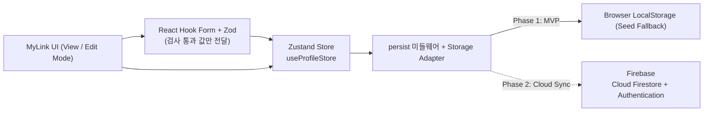
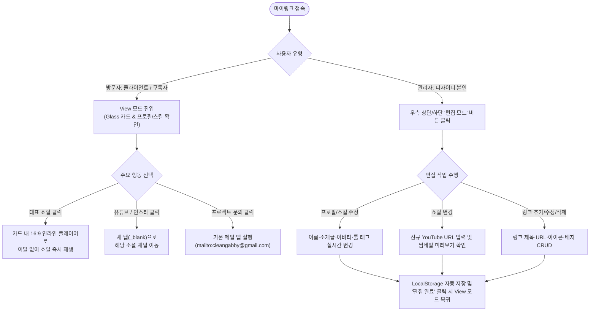

# PRD (제품 요구사항 및 기능 정의서) — 마이링크 (MyLink)

- **문서 버전:** v1.1 (2026-11-04: 기술 스택·상태관리·유효성 검사·/mypage·마일스톤 추가)
- **최초 버전:** v1.0
- **작성일:** 2026-10-07
- **프로젝트명:** 마이링크 (MyLink)
- **서비스 정의:** 모션그래픽 디자이너를 위한 인터랙티브 Glassmorphism 개인 프로필 & 쇼릴 링크 허브

---

## 1. 프로젝트 개요 (Overview)

### 1.1 배경 및 목적
모션그래픽 디자이너 **이대건**의 작업물(쇼릴, 유튜브, 인스타그램)과 외주 문의 창구를 하나의 URL로 연결하는 개인 전용 링크트리(Linktree) 웹 애플리케이션입니다. 단순한 링크 나열을 넘어, 디자이너의 감각을 보여주는 **ColorPallete 기반 웜 다크 Glassmorphism UI(가장자리 림라이트)**와 **대표 쇼릴 인라인 재생** 경험을 제공하며, 코드 수정 없이 웹 화면에서 즉시 콘텐츠를 관리할 수 있는 **실시간 편집 모드(Edit Mode)**를 지원합니다.

### 1.2 타겟 사용자
1. **관리자 (Owner):** 본인(모션그래픽 디자이너 이대건) — 브라우저 내 편집 모드를 통해 프로필, 기술 스택, 쇼릴 영상, 외부 링크를 추가·수정·삭제.
2. **방문자 (Visitors):** 클라이언트, 채용 담당자, 동료 디자이너 및 구독자 — 데스크탑·태블릿·모바일 환경에서 쇼릴 영상을 감상하고 주요 채널로 이동하거나 프로젝트 문의를 진행.

---

### 1.3 기술 스택 (Tech Stack)

| 영역 | 기술 | 용도 |
| :--- | :--- | :--- |
| 프레임워크 | **Next.js 16** (App Router, Turbopack) · **React 19** · **TypeScript** | 페이지 라우팅(`/`, `/mypage`), 클라이언트 컴포넌트 |
| 스타일 | **Tailwind CSS v4** · `tw-animate-css` | ColorPallete 토큰(`bg-hearth`, `text-winter` 등), 이징 토큰(`ease-punch` 등) |
| UI 프리미티브 | **shadcn/ui** 구조 + **@base-ui/react** · `cva` · `lucide-react` | 접근성 있는 버튼·스위치, 변형(variant) 분기, 아이콘 |
| 상태관리 | **Zustand 5** (+ `persist` 미들웨어) | 프로필·링크 전역 상태, localStorage 영속화 (`src/store/*`) |
| 폼 | **React Hook Form 7** (+ `@hookform/resolvers`) | 편집 모드·링크 모달·/mypage 입력 관리 |
| 유효성 검사 | **Zod 4** | 입력 규칙과 한국어 오류 문구를 스키마 하나로 정의 (`src/lib/schemas.ts`) |
| 저장소 | Phase 1: 브라우저 `localStorage` / Phase 2: **Firebase** (Cloud Firestore) | §2 로드맵 참조 |
| 백엔드 (BaaS) | **Firebase 13** — App · Cloud Firestore · Authentication · Analytics (프로젝트 `my-dae-link`) | 초기화 완료(§2.1). Firestore·Auth 연동은 M6 |

---

## 2. 데이터 아키텍처 및 단계별 로드맵 (Phased Roadmap)

향후 클라우드 DB 확장을 고려하여 **UI 컴포넌트와 데이터 저장소(Storage Layer)를 분리**하여 설계합니다.

- **상태관리는 Zustand로 일원화합니다.** 컴포넌트는 스토어의 상태와 액션(`addLink`, `updateLink`, `deleteLink`, `moveLink`, `addSkill`, `removeSkill`, `updateShowreel`, `resetProfile` 등)만 사용하고, 저장 방식은 알지 못합니다.
- **스토어 구성**

  | 스토어 | 파일 | 영속화 | 역할 |
  | :--- | :--- | :--- | :--- |
  | `useProfileStore` | `src/store/profile-store.ts` | `persist` → localStorage `mylink_state_v1` | 메인 허브 프로필·쇼릴·링크 |
  | `useMyPageStore` | `src/store/mypage-store.ts` | 없음 (메모리, M4 실습 범위) | `/mypage` 내 링크 관리 목록 |

- 저장 형식은 기존과 같은 순수 `ProfileData` JSON이라 이전 데이터가 그대로 읽히며, 일부 값이 깨져 있으면 기본값으로 채워 복구합니다.
- SSR과 첫 화면을 맞추기 위해 `skipHydration`으로 두고, 브라우저 마운트 후 `persist.rehydrate()`로 불러옵니다.
- Phase 2에서는 스토어의 Storage Adapter만 DB 연동으로 교체합니다.



| 단계 | 저장 방식 | 주요 목표 및 특징 |
| :---: | :--- | :--- |
| **Phase 1 (현재 MVP)** | **LocalStorage + 기본 시드 데이터** | • 최초 접속 시 코드에 정의된 기본 프로필/링크 데이터 로드<br/>• 편집 모드에서 수정 시 브라우저 `localStorage`에 즉시 반영 및 유지<br/>• 기본값 복원(Reset to Default) 기능 제공 |
| **Phase 2 (추후 확장)** | **Firebase (Cloud Firestore + Authentication)** | • 간단한 관리자 비밀번호/핀(PIN) 인증을 통한 편집 권한 보호<br/>• 수정 사항이 DB에 저장되어 모든 외부 방문자에게 실시간 동기화 |

### 2.1 Firebase 설정 (Setup)
- **프로젝트:** `my-dae-link` (웹 앱). SDK: `firebase` npm 패키지 (모듈식 v9+ API).
- **환경 변수:** 설정값은 코드에 직접 쓰지 않고 `.env.local`의 `NEXT_PUBLIC_FIREBASE_*` 변수로 주입합니다. `.env.local`은 git에서 제외되고, 형식은 커밋되는 `.env.example`로 공유합니다.

  | 변수 | 설명 |
  | :--- | :--- |
  | `NEXT_PUBLIC_FIREBASE_API_KEY` | 웹 API 키 |
  | `NEXT_PUBLIC_FIREBASE_AUTH_DOMAIN` | 인증 도메인 |
  | `NEXT_PUBLIC_FIREBASE_PROJECT_ID` | 프로젝트 ID |
  | `NEXT_PUBLIC_FIREBASE_STORAGE_BUCKET` | Storage 버킷 |
  | `NEXT_PUBLIC_FIREBASE_MESSAGING_SENDER_ID` | 메시징 발신자 ID |
  | `NEXT_PUBLIC_FIREBASE_APP_ID` | 앱 ID |
  | `NEXT_PUBLIC_FIREBASE_MEASUREMENT_ID` | (선택) Google Analytics 측정 ID |

- **초기화 모듈 (`src/lib/firebase.ts`):** 앱을 한 번만 만들고(`getApps`) 다음을 내보냅니다.
  - `firebaseApp` — Firebase 앱 인스턴스
  - `db` — Cloud Firestore (Phase 2 프로필·링크 저장소)
  - `getFirebaseAuth()` — Authentication (Phase 2 관리자 로그인, 브라우저 전용)
  - `initFirebaseAnalytics()` — 브라우저이고 지원되는 환경이며 측정 ID가 있을 때만 Analytics를 켭니다.
  - `isFirebaseConfigured` — 필수 값이 비어 있으면 개발 중 콘솔에 경고합니다.
- **Analytics:** 루트 레이아웃의 `<FirebaseAnalytics />`가 앱 시작 시 한 번 초기화합니다.
- **보안 메모:** 웹 API 키는 브라우저에 노출되는 공개 식별자이므로, 실제 보호는 **Firestore 보안 규칙**과 Google Cloud 콘솔의 **API 키 제한(허용 도메인)**으로 합니다. M6에서 보안 규칙을 "관리자만 쓰기, 누구나 읽기"로 설정합니다.
- **Next.js 참고:** `NEXT_PUBLIC_` 값은 `next build` 시점에 번들에 고정됩니다. 값을 바꾸면 개발 서버 재시작 또는 재빌드가 필요합니다.

---

## 3. 핵심 기능 정의 (Functional Requirements)

### 3.1 화면 모드 전환 (View Mode ↔ Edit Mode)
- **진입 방식:** 별도의 `/admin` 페이지 이동 없이, 화면 우측 상단(또는 하단)의 플로팅 **`편집 모드 (Edit)` 토글 버튼**을 클릭하여 즉시 전환합니다.
- **실시간 미리보기 (Live Preview):** 편집 모드 활성화 시 기존 Glassmorphism 카드 레이아웃을 유지한 채 각 영역(프로필, 쇼릴, 링크 아이템)에 수정·삭제 컨트롤과 추가 버튼이 나타나며, 변경 결과를 실시간으로 확인합니다.

### 3.2 프로필 정보 관리 (Profile Management)
| 항목 | 상세 요구사항 |
| :--- | :--- |
| **프로필 아바타** | • `120px × 120px` 원형 Glass 프레임 + `60FPS` 포인트 배지<br/>• 이미지 URL 입력 시 프로필 사진 렌더링, 미입력 시 텍스트 이니셜(`이`) 표시 |
| **기본 텍스트 정보** | • **이름(H1):** 예) `이대건`<br/>• **직무 타이틀(Label):** 예) `Motion Graphic Designer`<br/>• **소개 문구(Body):** 멀티라인(줄바꿈) 지원 자기소개 텍스트 편집 |
| **기술 스택 태그 (Skills)** | • 보유 툴 태그(`After Effects`, `Blender`, `3ds Max`, `Photoshop`, `Illustrator`, `Premiere Pro` 등) 추가 및 개별 삭제(`×`) 지원 |

### 3.3 대표 쇼릴(Showreel) 인라인 재생 및 미리보기 (Featured Showreel Player)
- **기능 설명:** 모션그래픽 디자이너의 핵심 포트폴리오인 **대표 쇼릴 영상**을 외부 사이트로 이탈하지 않고 마이링크 카드 안에서 바로 재생하거나 미리 볼 수 있는 전용 미디어 블록입니다.
- **상세 동작:**
  1. 편집 모드에서 YouTube URL(예: `https://youtu.be/...` 또는 `https://www.youtube.com/watch?v=...`)과 쇼릴 제목·부제목을 입력합니다.
  2. 유튜브 비디오 ID를 자동 추출하여 고화질 썸네일과 재생(Play) 오버레이 버튼을 카드 내에 렌더링합니다.
  3. 방문자가 재생 버튼을 클릭하면 카드 내 `16:9` 반응형 인라인 플레이어(iframe)로 즉시 전환되어 영상이 재생되며, 필요 시 접기/닫기가 가능합니다.

### 3.4 링크 CRUD 관리 (Link Management)
- **링크 데이터 구조:**
  - `id`: 고유 식별자 (`string`)
  - `title`: 링크 제목 (필수, 예: `YouTube Channel`)
  - `subtitle`: 부연 설명 (선택, 예: `모션그래픽 개인작 & 작업 과정`)
  - `href`: 이동할 URL 또는 `mailto:` 이메일 주소 (필수)
  - `iconType`: 아이콘 프리셋 선택 (`play` 쇼릴/영상, `youtube` 유튜브, `instagram` 인스타그램, `film` 포트폴리오/아카이브, `sparkles` 클래스/하이라이트, `globe` 웹사이트/스토어, `link` 일반 외부 링크, `mail` 이메일/외주 문의)
  - `badge`: 강조 배지 텍스트 (선택, 예: `FEATURED`, `NEW`)
  - `variant`: 버튼 스타일 (`primary` Hearth 강조형 / `glass` 반투명 유리 기본형)
- **CRUD 동작:**
  - **추가 (Create):** 리스트 하단 `+ 새 링크 추가` 버튼을 눌러 글래스 모달(또는 인라인 폼)에서 새 링크 생성
  - **수정 (Update):** 편집 모드에서 개별 링크의 `수정` 아이콘 클릭 시 기존 값을 불러와 즉시 편집
  - **삭제 (Delete):** 편집 모드에서 개별 링크의 `삭제` 아이콘 클릭 시 해당 링크 제거

### 3.5 편집 유효성 검사 (Validation — Zod + React Hook Form)
- **원칙:** 모든 입력 규칙은 `src/lib/schemas.ts`의 Zod 스키마 한 곳에서 정의하고, React Hook Form이 `zodResolver`로 검사합니다. 오류 문구는 입력 칸 바로 아래에 한국어로 표시하고(`FieldError`), 오류가 있는 칸은 `aria-invalid`로 표시되어 테두리가 Danger 색으로 바뀝니다.
- **저장 규칙:** 편집 모드의 실시간 자동 저장은 **검사를 통과한 값만** 스토어에 반영합니다. 잘못된 값을 입력하는 동안 방문자 화면에는 마지막 정상 값이 유지됩니다.
- **검사 시점:** 프로필·쇼릴은 입력할 때마다(`onChange`), 링크 모달·스킬 추가·/mypage는 첫 제출 후부터 입력할 때마다 다시 검사합니다.

| 대상 | 필드 | 규칙 |
| :--- | :--- | :--- |
| 프로필 | 이름 | 필수, 20자 이내 |
| | 직무 타이틀 | 필수, 40자 이내 |
| | 소개글 | 200자 이내 |
| | 아바타 이니셜 | 필수, 2자 이내 |
| | 포인트 배지 | 10자 이내 |
| | 프로필 이미지 URL | 비워도 됨, 입력 시 `http(s)://` |
| 기술 스택 | 새 스킬 | 필수, 20자 이내, 대소문자 무시 중복 금지 |
| 대표 쇼릴 | 제목 | 필수, 40자 이내 |
| | YouTube URL | 필수, 영상 ID를 추출할 수 있는 YouTube 주소 |
| | 부제목 / 배지 | 60자 / 10자 이내 |
| 링크 (모달) | 제목 | 필수, 40자 이내 |
| | 이동 주소 | 필수, `http(s)://` 또는 `mailto:이메일` |
| | 부제목 / 배지 | 60자 / 10자 이내 |
| /mypage | 제목 | 필수(빈 칸 금지), 40자 이내 |
| | 주소 | 필수(빈 칸 금지), `http(s)://` 또는 `mailto:이메일` |

### 3.6 내 링크 관리 페이지 (`/mypage`)
- **목적:** 링크 추가(Create) 흐름을 독립 페이지에서 구현하는 7주차 실습 화면입니다. 메인 화면 상단의 `내 링크 관리` 버튼으로 이동합니다.
- **페이지 구조:** 상단 `내 링크 관리` 제목 / 중간 추가 폼 / 하단 링크 목록.
- **폼 요소:** 제목 입력 칸, 주소 입력 칸(세로 배치), `추가` 버튼. 버튼은 프로젝트 팔레트 규칙에 따라 Hearth primary 버튼을 사용합니다 (실습 예시의 보라색 `#5B5FC7` 대신).
- **동작:**
  1. `추가` 클릭 → 빈 칸·주소 형식 검사 (§3.5)
  2. 통과 시 목록 하단에 추가
  3. 입력 칸 자동 비우기 + 제목 칸으로 포커스 이동
  4. 목록의 휴지통 버튼으로 삭제
- **저장 범위:** M4에서는 메모리 상태만 사용하므로 **새로고침하면 목록이 사라집니다** (체크리스트 테스트 항목). 영속화는 M5에서 추가합니다.

---

## 4. 데이터 스키마 명세 (Data Model)

Phase 1(`localStorage` key: `mylink_state_v1`)과 Phase 2(DB 테이블/문서)에서 공통으로 사용할 JSON 스키마입니다.

```typescript
export type LinkIconType =
  | "play"
  | "youtube"
  | "instagram"
  | "mail"
  | "film"
  | "globe"
  | "link"
  | "sparkles";

export interface LinkItem {
  id: string;
  title: string;
  subtitle: string;
  href: string;
  iconType: LinkIconType;
  badge?: string;
  variant: "primary" | "glass";
}

export interface ShowreelConfig {
  enabled: boolean;
  title: string;
  subtitle: string;
  youtubeUrl: string;
  badge?: string;
}

export interface ProfileData {
  name: string;
  role: string;
  bio: string;
  avatarText: string;
  avatarImageUrl?: string;
  fpsBadge: string;
  skills: string[];
  showreel: ShowreelConfig;
  links: LinkItem[];
}
```

---

## 5. 디자인 시스템 및 UI/UX 요구사항 (shadcn/ui × Glassmorphism Design System)

프로젝트 내 [Design.md](./Design.md) 규격을 준수하며, **단순히 기본 `shadcn/ui` 스타일을 그대로 사용하는 것이 아니라, `shadcn/ui`의 컴포넌트 아키텍처(`@base-ui/react`, `cva`, `cn`) 위에 Glassmorphism 머티리얼을 결합한 전용 디자인 시스템(Glass-UI System)으로 구축합니다.**

### 5.1 설계 철학 (Core Architecture)
- **구조와 접근성은 `shadcn/ui`, 시각 머티리얼은 `Glassmorphism`:**
  - 포커스 관리, 키보드 내비게이션, ARIA 속성, 변형(Variant) 분기 등 컴포넌트의 뼈대는 `src/components/ui`의 `shadcn/ui` 프리미티브를 기반으로 합니다.
  - 반면 기존의 불투명(Solid) 배경과 단색 보더를 모두 제거하고, **반투명 프로스티드 유리 표면(`backdrop-filter`)**이 모든 `shadcn/ui` 컴포넌트의 기본 시각 언어(Visual Language)로 작동하도록 커스터마이징합니다. 마우스 위치에 반응하는 림라이트(`.glass-rim`)는 **바탕이 되는 메인 카드에만** 적용합니다.

### 5.2 Glassmorphism 디자인 토큰 매핑 (`src/app/globals.css`)
`shadcn/ui`의 시맨틱 CSS 변수를 프로젝트 루트의 `ColorPallete.jpeg` 6색으로 1:1 매핑합니다. 글래스 가장자리의 **커서 반응형 림라이트(`.glass-rim`)**는 유지합니다. **메인 카드(가장 바탕이 되는 블록)에만** 적용하며, 유리판 가장자리를 따라 균일하게 맺히는 빛(inset glow)이 마우스 위치를 중심으로 방사형으로 드러납니다. 마우스와 가까운 가장자리일수록 밝고 멀어질수록 희미해집니다. 테두리 선은 쓰지 않고, 마우스 주변 허공에 뜨는 빛 덩어리나 표면 전체 광택도 쓰지 않습니다.

| `shadcn/ui` 토큰 | Glassmorphism 매핑 값 | 역할 및 시각적 특징 |
| :--- | :--- | :--- |
| `--background` | `#1E0912` (Crow) | 순수 검정을 배제한 웜 다크 베이스 배경 |
| `--foreground` | `#F5ECD1` (Winter White) | 유리 표면 위에서도 4.5:1 이상 명도 대비를 보장하는 텍스트 컬러 |
| `--card` | `rgba(245, 236, 209, 0.08)` | 메인 프로필/링크 카드용 반투명 화이트 유리 표면 (`blur(16px) saturate(180%)` 결합) |
| `--popover` | `rgba(43, 32, 52, 0.92)` (Bleached Cedar) | 모달(`Dialog`)·드롭다운(`Select`)용 고밀도 다크 프로스티드 글래스 표면 (`blur(20px)`) |
| `--primary` | `#E1CAA6` (Hearth) | 핵심 액션 버튼, 대표 쇼릴 강조, 포커스 인디케이터 (글자색은 Crow) |
| `--secondary` | `rgba(245, 236, 209, 0.1)` | 보조 유리 버튼, 스킬 태그칩(`Badge`) 기본 표면 |
| `--accent` | `rgba(55, 67, 95, 0.6)` | Diplomatic(`#37435F`) 기반 호버/활성 하이라이트 표면 |
| `--border` / `--input` | `rgba(245, 236, 209, 0.08)` / `0.16` | 유리 단면의 빛 반사를 표현하는 `1px` 반투명 보더 및 입력창 외곽선 |
| `--ring` | `#E1CAA6` | 키보드 포커스 및 입력 활성 시 표시되는 `2px` Hearth 포커스 링 |
| **서브 액센트 토큰** | `#37435F` / `#74838A` / `#2B2034` | Diplomatic, Bay Wharf, Bleached Cedar — 고정 배경 광원 및 아이콘/배지 포인트 |
| `--destructive` | `#D98C7A` | 팔레트 밖 유일한 의미색 — 삭제 버튼·오류 문구 전용 |

### 5.3 `shadcn/ui` 컴포넌트별 Glassmorphism 구축 규격 (`src/components/ui/*`)
앞으로 추가·구현하는 모든 `shadcn/ui` 컴포넌트는 아래의 Glassmorphism 디자인 시스템 규격으로 확장하여 구축합니다.

1. **`Button` (`src/components/ui/button.tsx`):**
   - `default` (`primary` 변형): Hearth(`#E1CAA6`) 액센트 필 + Crow(`#1E0912`, `on-primary` 토큰으로 변경 가능) 글자색 + 상단 유리 광택 + 호버 시 8% 다크닝 및 리프트 섀도우 + 클릭 시 `-1px` 택타일 프레스(`active:-translate-y-px`).
   - `glass` / `outline` / `secondary` 변형: `bg-winter/14 hover:bg-winter/20 backdrop-blur-md border border-winter/[0.08]` 반투명 유리 버튼 스타일.
2. **`Card` (`src/components/ui/card.tsx`):**
   - `rounded-[20px] backdrop-blur-[16px] backdrop-saturate-[180%] bg-card border-winter/[0.08] shadow-[0_12px_40px_0_rgba(12,3,7,0.5)]`를 내장한 컨테이너 컴포넌트로 구축.
3. **`Input` & `Textarea` & `Label` (`src/components/ui/input.tsx` 등):**
   - 편집 모드에서 사용하는 모든 입력 필드는 플로팅 라벨 없이 상단 고정 `Label` + 반투명 유리 입력창(`bg-winter/10 backdrop-blur-md border-winter/22 text-foreground placeholder:text-winter/45`)으로 구성하며, 포커스 시 `2px` Hearth 포커스 링(`ring-offset-2`)을 적용.
4. **`Badge` (`src/components/ui/badge.tsx`):**
   - 기술 스택 태그(`After Effects`, `Blender` 등)와 포인트 배지(`60FPS`, `FEATURED`, `NEW`)를 표현하는 프로스티드 글래스 칩(`backdrop-blur-sm bg-white/14 border-white/25`).
5. **`Dialog` / `Select` / `Switch` (편집 모드 오버레이 및 컨트롤):**
   - 링크 추가·수정 모달 및 컨트롤은 `z-index` 계층(`overlay: 200`, `modal: 300`, `toast: 500`)을 준수하며, 배경 블러 오버레이 위에 다중 레이어 유리 패널로 렌더링.

### 5.4 반응형 및 모션 원칙
- **반응형 카드 규격:**
  - **모바일 (`360px ~ 767px`):** 카드 너비 `100%`, 패딩 `20px`
  - **태블릿 (`768px ~ 1023px`):** 카드 너비 `80%` (최대 `480px`), 패딩 `28px`
  - **데스크탑 (`1024px ~`):** 카드 너비 `400px` 고정, 패딩 `28px`
- **아이콘 및 애니메이션:**
  - UI 내 이모지 사용을 배제하고 `lucide-react` 아이콘 시스템만 사용합니다.
  - 진입 시 `420ms` 페이드+슬라이드 업(`16px → 0`), 리스트 아이템 간 `80ms` 스태거드 애니메이션, `tw-animate-css` 기반 상태 전환(`transform`, `opacity` 한정)을 적용합니다.
  - **이징:** 기본 Easy Ease(대칭 33 %)나 평범한 `ease-out`은 쓰지 않고, After Effects 속도 그래프식 비대칭 곡선을 씁니다 (Design.md `motion` 토큰).
    - `ease-punch` `cubic-bezier(0.10, 0, 0.05, 1)` — 확 치고 길게 감속 (10 % / 95 %): 진입, 호버
    - `ease-swoosh` `cubic-bezier(0.85, 0, 0.15, 1)` — 천천히 → 슉 → 천천히 (85 % / 85 %): 쇼릴 펼침·접힘, 모달 열림, 페이지 전환
    - `ease-snap` `cubic-bezier(0.90, 0, 0.90, 1)` — 길게 모았다가 탁 (90 % / 10 %): 배지·저장 완료 같은 강조

---

## 6. 사용자 시나리오 (User Scenarios)

### 6.1 전체 사용자 여정 흐름도 (User Flow)



---

### 6.2 시나리오 A: 외주 클라이언트 / 채용 담당자 (데스크탑 환경)
- **페르소나:** 브랜드 캠페인 모션그래픽 제작을 맡길 디자이너를 찾고 있는 에이전시 PD 김 대리
- **상황 및 목표:** 인스타그램 프로필이나 명함에 적힌 마이링크 URL을 통해 데스크탑 브라우저로 접속하여 디자이너의 작업 역량(2D/Fake 3D, 사용 툴)을 빠르게 검증하고 연락하고 싶음.
- **상세 흐름 (Step-by-Step):**
  1. **첫인상 및 역량 파악:** 페이지 접속과 동시에 `420ms` 페이드업 애니메이션으로 Glassmorphism 카드가 등장한다. 마우스를 움직일 때마다 카드 **가장자리에 빛이 맺히는** 림라이트로 디자이너의 감각적인 디테일을 체감하고, `After Effects`, `Blender`, `3ds Max` 등 보유 기술 스택 태그를 한눈에 확인한다.
  2. **쇼릴 즉시 감상 (이탈 방지):** 최상단의 **`2026 Motion Showreel` (`FEATURED`)** 카드의 재생 버튼을 클릭한다. 유튜브 사이트로 창이 넘어가지 않고 카드 내부에서 즉시 `16:9` 영상 플레이어가 열려, 60FPS 모션그래픽 쇼릴을 끊김 없이 감상한다.
  3. **추가 작업물 확인 및 문의:** 작업 스타일이 마음에 들어 하단의 `YouTube Channel` 링크를 눌러 메이킹 필름을 새 탭에서 확인한 뒤, 다시 마이링크 탭으로 돌아와 **`프로젝트 및 외주 문의`** 버튼을 클릭하여 바로 의뢰 메일을 작성한다.

---

### 6.3 시나리오 B: SNS 팔로워 및 동료 디자이너 (모바일 환경)
- **페르소나:** 유튜브 쇼츠나 인스타그램 릴스에서 모션 작업물을 보고 유입된 모바일 사용자
- **상황 및 목표:** 스마트폰 인앱 브라우저로 접속해 다른 채널들을 구독하고 작업 과정을 살펴보고 싶음.
- **상세 흐름 (Step-by-Step):**
  1. **모바일 최적화 뷰 확인:** `360px~767px` 모바일 해상도에 맞춰 가로 너비 `100%`, 패딩 `20px`로 최적화된 글래스 카드를 스크롤 부담 없이 한 화면에서 확인한다.
  2. **채널 이동:** `YouTube Channel` 또는 `Instagram` 카드를 터치하면 `-1px` 택타일 프레스 피드백과 함께 해당 채널로 즉시 이동하여 구독 및 팔로우를 진행한다.

---

### 6.4 시나리오 C: 디자이너 본인 — 콘텐츠 업데이트 및 링크 관리 (편집 모드)
- **페르소나:** 모션그래픽 디자이너 **이대건** (서비스 소유자)
- **상황 및 목표:** 새로운 개인작 영상을 유튜브에 업로드한 직후, 코드를 다시 짜거나 배포할 필요 없이 웹 화면에서 바로 대표 쇼릴 영상을 교체하고 신규 링크를 추가하고 싶음.
- **상세 흐름 (Step-by-Step):**
  1. **편집 모드 진입:** 마이링크 페이지 우측 상단(또는 하단)의 플로팅 **`편집 모드`** 버튼을 클릭한다.
  2. **프로필 및 스킬 태그 업데이트:** 새로 익힌 툴이나 변경된 자기소개 문구를 인라인 입력창에서 수정하고, 기술 스택 영역에서 새 태그를 입력해 추가하거나 기존 태그의 `×` 버튼을 눌러 정리한다.
  3. **대표 쇼릴 URL 교체:** 쇼릴 설정 입력란에 새로 업로드한 유튜브 영상 주소를 붙여넣는다. 즉시 새로운 영상의 썸네일 미리보기가 카드에 반영되는 것을 확인한다.
  4. **링크 추가 및 수정 (CRUD):**
     - 하단 **`+ 새 링크 추가`** 버튼을 클릭해 제목(`Coloso 강의 오픈`), 부제목, URL, 아이콘, 강조 배지(`NEW`)를 입력하고 저장한다.
     - 기존 링크 중 수정이 필요한 항목의 `수정` 버튼을 눌러 문구를 다듬거나, 더 이상 쓰지 않는 링크의 `삭제` 버튼을 눌러 목록에서 제거한다.
  5. **저장 및 확인:** 모든 수정 사항은 즉시 브라우저 `localStorage`에 자동 저장된다. **`편집 완료`** 버튼을 눌러 일반 방문자 시점(View Mode)으로 전환한 뒤, 림라이트, 색상, 레이아웃이 잘 적용되었는지 최종 확인한다. (필요 시 `기본값 복원` 버튼으로 초기 시드 상태로 되돌릴 수 있다.)

---

## 7. 메인 화면 와이어프레임 (Wireframes)

### 7.1 기본 메인 화면 (View Mode — 방문자 시점)

```text
+-----------------------------------------------------------------------+
|  Viewport (min-h-[100dvh], Crow #1E0912 + Static Light Pools)        |
|                                                    [ ✎ 편집 모드 ]    |
|                                                                       |
|           +-----------------------------------------------+           |
|           |  ══════════ Warm Dark Glass Card ═══════════ |           |
|           |  (Mobile 100% / Tablet 80% / Desktop 400px)   |           |
|           |                                               |           |
|           |                  .---------.                  |           |
|           |                 /           \                 |           |
|           |                |     이      | (120 x 120px)  |           |
|           |                 \           /  [60FPS]        |           |
|           |                  '---------'                  |           |
|           |                                               |           |
|           |                    이대건                      | <-- H1    |
|           |          [🎬] MOTION GRAPHIC DESIGNER         | <-- Label |
|           |                                               |           |
|           |    움직임으로 이야기를 전하는 모션그래픽      | <-- Body  |
|           |  디자이너입니다. 브랜드의 메시지를 만듭니다.   |           |
|           |                                               |           |
|           |  [After Effects] [Blender] [3ds Max]          | <-- Chips |
|           |  [Photoshop] [Illustrator] [Premiere Pro]     |           |
|           |                                               |           |
|           |  -------------------------------------------  |           |
|           |                                               |           |
|           |  +-----------------------------------------+  |           |
|           |  | [▶] 2026 Motion Showreel   [FEATURED] ▾ |  | <-- 쇼릴  |
|           |  |     2D · Fake 3D · Kinetic 대표 작업물  |  | (Primary) |
|           |  +-----------------------------------------+  |           |
|           |                                               |           |
|           |  +-----------------------------------------+  |           |
|           |  | [▷] YouTube Channel                   → |  | <-- 링크1 |
|           |  |     모션그래픽 개인작 & 작업 과정       |  |  (Glass)  |
|           |  +-----------------------------------------+  |           |
|           |                                               |           |
|           |  +-----------------------------------------+  |           |
|           |  | [◎] Instagram                         → |  | <-- 링크2 |
|           |  |     짧은 모션 실험실 & 아트워크 노트    |  |  (Glass)  |
|           |  +-----------------------------------------+  |           |
|           |                                               |           |
|           |  +-----------------------------------------+  |           |
|           |  | [✉] 프로젝트 및 외주 문의             → |  | <-- 링크3 |
|           |  |     cleangabby@gmail.com                |  |  (Glass)  |
|           |  +-----------------------------------------+  |           |
|           |                                               |           |
|           |               © 2026 Lee Dae-geon             | <-- Footer|
|           +-----------------------------------------------+           |
|                                                                       |
+-----------------------------------------------------------------------+
```

### 7.2 대표 쇼릴 인라인 재생 확장 상태 (Showreel Expanded State)

방문자가 최상단 `2026 Motion Showreel` 카드를 클릭했을 때 페이지 이탈 없이 카드 내부에서 `16:9` 플레이어가 펼쳐진 모습입니다.

```text
           |  -------------------------------------------  |
           |  +-----------------------------------------+  |
           |  | [▶] 2026 Motion Showreel      [접기 ▲] |  |
           |  | +-------------------------------------+ |  |
           |  | |                                     | |  |
           |  | |       16:9 YouTube Inline Player    | |  |
           |  | |            ( ▶ Playing... )         | |  |
           |  | |                                     | |  |
           |  | +-------------------------------------+ |  |
           |  +-----------------------------------------+  |
```

### 7.3 실시간 편집 모드 화면 (Edit Mode — 관리자 시점)

우측 상단 `[ ✎ 편집 모드 ]` 토글 활성화 시 같은 화면 안에서 바로 프로필·쇼릴·링크를 수정·추가·삭제하는 레이아웃입니다.

```text
+-----------------------------------------------------------------------+
|  Viewport                                [ ↺ 기본값 복원 ] [ ✓ 완료 ] |
|                                                                       |
|           +-----------------------------------------------+           |
|           |  [EDIT MODE ACTIVE] 실시간 편집 및 미리보기   |           |
|           |                                               |           |
|           |              ( 이 ) [이미지 URL 변경]         |           |
|           |                                               |           |
|           |  이름:   [ 이대건                          ]  |           |
|           |  직무:   [ Motion Graphic Designer         ]  |           |
|           |  소개글: [ 움직임으로 이야기를 전하는...   ]  |           |
|           |                                               |           |
|           |  기술 스택:                                   |           |
|           |  [After Effects ×] [Blender ×] [3ds Max ×]    |           |
|           |  [+ 새 스킬 태그 입력...          ] [추가]    |           |
|           |                                               |           |
|           |  --- [ 대표 쇼릴(Showreel) 설정 ] ----------  |           |
|           |  제목: [ 2026 Motion Showreel              ]  |           |
|           |  YouTube URL: [ https://youtu.be/...       ]  |           |
|           |                                               |           |
|           |  --- [ 링크 목록 관리 (CRUD) ] -------------  |           |
|           |  +-----------------------------------------+  |           |
|           |  | [▷] YouTube Channel        [수정] [삭제]|  |           |
|           |  +-----------------------------------------+  |           |
|           |  +-----------------------------------------+  |           |
|           |  | [◎] Instagram              [수정] [삭제]|  |           |
|           |  +-----------------------------------------+  |           |
|           |  +-----------------------------------------+  |           |
|           |  | [✉] 프로젝트 및 외주 문의  [수정] [삭제]|  |           |
|           |  +-----------------------------------------+  |           |
|           |                                               |           |
|           |  +-----------------------------------------+  |           |
|           |  |           + 새 링크 추가하기            |  |           |
|           |  +-----------------------------------------+  |           |
|           +-----------------------------------------------+           |
+-----------------------------------------------------------------------+
```

---

## 8. 마일스톤 (Milestones)

| 마일스톤 | 상태 | 범위 | 완료 기준 |
| :--- | :---: | :--- | :--- |
| **M1. 프로필 페이지 기초** | 완료 | 프로필 페이지, README, 모션그래픽 디자이너 소개 | 기본 프로필 화면 표시 |
| **M2. 글래스 링크 허브 + 편집 모드** | 완료 | 글래스 카드, 대표 쇼릴 인라인 재생, 편집 모드, 링크 CRUD, localStorage 저장 | 편집 내용이 새로고침 후에도 유지 |
| **M3. 디자인 시스템 정비** | 완료 | ColorPallete 6색 토큰, 커서 반응형 번짐 림라이트, AE식 비대칭 이징 토큰 | Design.md 규격과 화면 일치 |
| **M4. 링크 추가 기능 (Create) — 7주차** | 완료 (2026-11-04) | `/mypage` 페이지, 링크 추가 폼(제목·주소·버튼), 추가 시 목록 반영, 입력 칸 자동 비우기, 빈 칸 검증 / Zustand 상태관리, Zod + React Hook Form 유효성 검사 도입 | 체크리스트 6개 항목 통과 (§8.1) |
| **M5. 목록 영속화 + 수정·삭제 통합** | 예정 | `/mypage` 목록에 `persist` 적용, 수정(Update) 추가, 메인 허브 링크와 하나의 스토어로 통합 | 새로고침 후에도 `/mypage` 목록 유지, 메인 카드에 반영 |
| **M6. Phase 2 — 클라우드 동기화** | 진행 중 | ✅ Firebase SDK 설치·초기화, 환경 변수, Analytics 연결 (2026-11-04) / ⬜ Firestore 저장소 어댑터, Firebase Auth 관리자 로그인, 보안 규칙, 배포 | 다른 기기의 방문자에게 수정 내용 반영 |

### 8.1 M4 체크리스트 (7주차 실습)
- [x] `/mypage` 페이지 만들기 — `src/app/mypage/page.tsx`
- [x] 링크 추가 폼 만들기 (제목, 주소, 버튼)
- [x] 추가 버튼 클릭 시 목록에 추가 — `useMyPageStore.addLink`
- [x] 입력 칸 자동으로 비우기 — 성공 시 `reset()` + 제목 칸 포커스
- [x] 빈 칸 검증 추가하기 — `quickLinkSchema` (Zod) + React Hook Form
- [x] 테스트: 링크 추가 → 새로고침 → 사라짐 확인 — 메모리 상태라 새로고침 시 목록 0개 (브라우저에서 확인)
